  
  &nbsp;
  
  &nbsp;
  

### Now

I build the models and maps behind early warnings at **IGAD-ICPAC**, the climate centre for the Greater Horn of Africa.

- Retraining a **conditional GAN (WGAN-GP)** that turns ECMWF IFS forecasts into sharp, probabilistic rainfall for 11 countries, learning from RFE2 satellite rainfall
- Building **drought and flood vulnerability profiles** from exposure, susceptibility and resilience layers for IGAD countries
- Writing Python training manuals and teaching them to colleagues from IGAD member states
- Statistician by training: BSc Statistics, Jomo Kenyatta University of Agriculture and Technology

 

### Featured work

| Project | What it is |
|---|---|
| [**SEWAA-forecasts-RFE2**](https://github.com/limoezra/SEWAA-forecasts-RFE2) | cGAN rainfall downscaling for the ICPAC region, retrained on RFE2 daily rainfall. 384 × 352 grid at 0.1°, CRPS and RMSE evaluation |
| [**SEWAA-forecasts**](https://github.com/limoezra/SEWAA-forecasts) | Operational cGAN rainfall forecasts for the ICPAC region (fork of ICPAC's repo) |
| [**portfolio**](https://github.com/limoezra/portfolio) | My site: rain fields made of noise, a scroll-driven downscaling demo and a vulnerability layer stack. Astro + GSAP |

### Publications

- **2025** · Pfeiffer, S., **Kiplimo, E.**, et al. *Bridging the gaps: Vulnerability profiles to strengthen impact-based early warning and early action for floods and droughts in Kenya.* UNU-EHS, Bonn.
- **2026** · Sabiiti, G., Amdihun, A., Wekesa, K., Igbokwe, V., **Kiplimo, E.** *Towards Anticipatory Disaster Risk Financing and Index Insurance Mechanisms for Resilience Building in Eastern Africa.*

### Toolbox

**Machine learning**
 

**Geospatial**
 

**Data and statistics**
 

**Visualisation**
 

 

rain made of noise · 1.29°S 36.82°E

